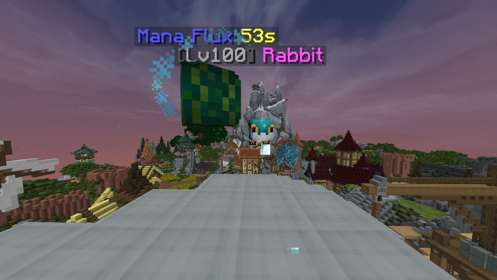

# SkyCosmetics

**Hypixel SkyBlock skins, dyes, names and glint, on your own gear and pets.** Choose catalog skins
on your helmets, items and pets, dye any armor with any dye (animated ones included), rename items and restyle their
glint, and see it everywhere: in every menu, in your hand, on your player model and on your summoned pet.

Purely visual. SkyCosmetics only changes how things are drawn on your screen: it never sends anything to the server
on its own, clicks nothing, and other players see Hypixel's items as usual.

> Formerly **Skin Studio**. Replace its jar with this one: your looks, settings and open key carry over on the first
> start.

## Features

- **Skins and variants.** Browse catalog helmet, pet and power orb skins, their color variants and SkyBlock heads, or
  paste any texture. Animations play at the speed Hypixel plays them: timings measured in game ship with the mod, and
  your game measures any animated head it sees and fixes the timing on its own.
- **New skins without an update.** Skins, styles and timings published after a release arrive by themselves (one small
  file from GitHub every few hours), and skins Hypixel shows you that the catalog doesn't have yet are remembered.
- **Every dye, on any armor.** All static and animated Hypixel dyes, any hex color, or your own animated dye.
  Animated dyes ripple from boots to helmet like on Hypixel.
- **Models and armor trims.** Pick a vanilla appearance and trim pattern inline in the studio; armor remodels change
  the worn look as well as the icon.
- **Names and glint.** Rename items with color codes, a picker or one-click gradients, and turn the enchant glint on
  or off per item with any color, speed and strength. Display only: other mods still see Hypixel's real name.
- **Pets and power orbs in the world.** Your summoned pet and deployed power orb wear the skin you picked: Hypixel's own
  entity, reskinned. Nothing extra is spawned.
- **Rarity Backgrounds.** The slot behind each item in its rarity's color, in your inventory, menus, hotbar and the
  equipment panels other mods add, with shapes, fills and your own colors.
- **Head Size.** Make skull items in menus a little bigger or smaller.
- **Nametags.** Your own name in a solid color, gradient or chroma, with a background plate, scale and fade.
- **Tooltips.** Scroll long tooltips with the wheel, fit them to the screen, and give them your own background and
  border.
- **Viewmodel.** Move, turn and resize your hand and held item, with cosmetic swing controls and six saved setups.
- **Zoom.** Optional: hold or toggle, smooth animation, wheel adjustment and gentle sensitivity. Off until you enable
  it.
- **My Items and Favorites.** Everything you wear, hold and have seen in one searchable list; star the skins and dyes
  you use most.

## How to use

- Open your inventory and click the small **brush** next to your player, or hover any item in any menu and press your
  **open key** (unbound at first: set it in the settings or in Controls), or type `/skycosmetics edit`.
- Pick an item on the left, then click a skin, dye or name on the right. It applies at once; there is nothing to save.
- **Reset** returns the item to its original look. A look for every item of a type shows only on your own items, never
  on items in auction, bazaar, trade or shop menus.
- The **Saved** tab lists everything you changed, by section; click a look to remove one change at a time.

| Command | What it does |
|---|---|
| `/skycosmetics` | Opens the settings (the same screen as Mod Menu's Configure button). |
| `/skycosmetics edit` | Opens the editor for your held item (or your helmet). |
| `/skycosmetics debug pet`, `orb`, `item` | What the pet and orb reskin see, or the last item you hovered in a menu, for bug reports. |

## FAQ

**Is it safe to use on Hypixel?** It is purely visual: it only changes how things are drawn on your client. It sends
no packets of its own, automates nothing and gives no gameplay advantage, the same kind of feature Skyblocker and
SkyOcean offer. Sneaking players' names stay hidden behind walls exactly as in vanilla. As with any mod, you use it
under Hypixel's rules on allowed modifications.

**What does it download?** Only public files, and nothing about you is sent: the community item repo (only when
neither Skyblocker nor Firmament is installed), the published skins file from
[SkyCosmetics-data](https://github.com/Terabold/SkyCosmetics-data), and the list of SkyCosmetics releases for the
update check. The last two can be turned off in the settings.

**Can other players see my looks?** No. Only you see them.

**Does it work with Skyblocker, SkyOcean and Firmament?** Yes. When another mod also customizes an item, the editor
marks it ("Dyed by Skyblocker"), and the **Other Mods** tab lists them. Sections whose feature another installed mod
also has say so, so you can keep one of the two on.

**A skin is missing or blinks at the wrong speed?** Wear or look at it for a moment: your game learns its frames and
timing. Report the skin's name on the issue tracker so it can be published for everyone.

## Install

- Download the jar from [Releases](https://github.com/Terabold/SkyCosmetics/releases) and put it in your `mods`
  folder. The update checker offers newer versions in the settings.
- Built and tested on Minecraft 26.1.2 with Fabric Loader 0.19.5, Fabric API and Java 25.
- Optional: Mod Menu (a Configure button), Skyblocker or Firmament (SkyCosmetics reuses their copy of the item repo).

## Made with AI

SkyCosmetics' code is developed with Anthropic's Claude and OpenAI's Codex, directed and tested in game by the author. It
is disclosed here because players deserve to know. Bug reports and pull requests are welcome on the
[issue tracker](https://github.com/Terabold/SkyCosmetics/issues).

## Credits

Skin and dye data from the [NotEnoughUpdates repository](https://github.com/NotEnoughUpdates/NotEnoughUpdates-REPO).

Not affiliated with Hypixel Inc. or Mojang Studios.

## License

[MIT](LICENSE)
